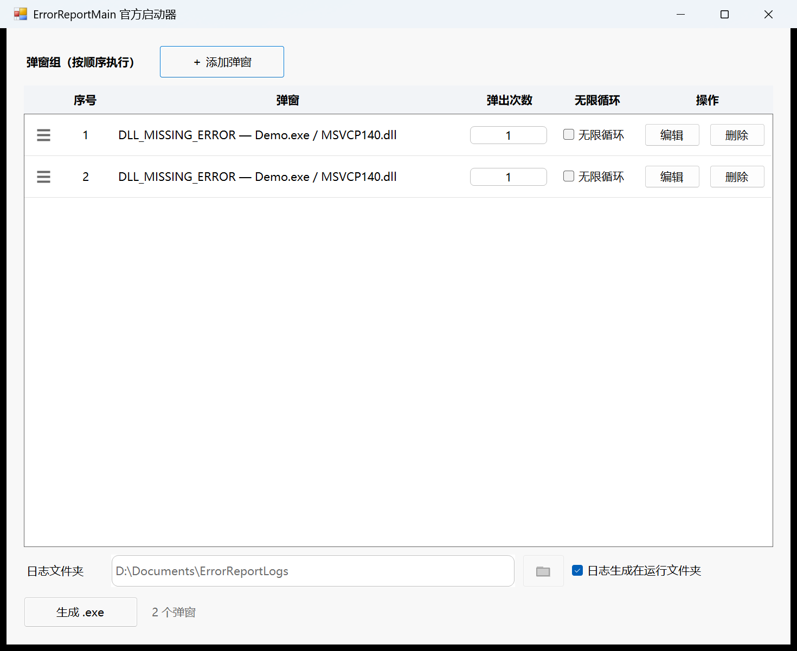
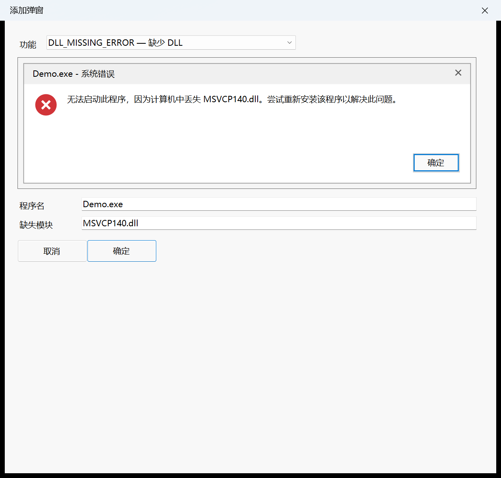
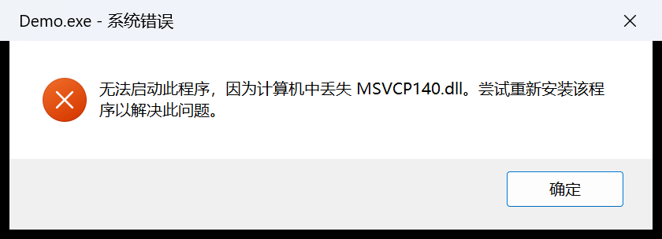

# ErrorReportMain 官方启动器

这是一个可选的图形化工具，用来自定义并生成“点开就弹错误框”的小 exe。
不想自己写 C/C++/C# 调用代码时，可以直接用这个启动器。

## 环境

- Windows 10 / 11
- .NET Framework 4.8（Windows 10 1903+ / Windows 11 自带）
- Visual Studio 2026 或 .NET SDK，用来构建启动器
- 先构建项目的 **x64 Release DLL**
- 当前启动器按 **x64** 构建；启动器生成时需要同目录的 x64 `ErrorReportMain.dll`，
  生成出的 exe 会把 x64 DLL 内嵌，可以单独移动
- 启动器和生成 exe 内嵌 comctl32 v6 manifest；启动器通过 `DpiHelper` 读取实际 DPI 并手动缩放，
  不再需要 `ErrorReportLauncher.exe.config`，175% 缩放下字体和控件按物理像素渲染，
  不需要手动设置兼容性里的高 DPI 覆盖
- 如果把 DLL 嵌入到没有 manifest 的原生宿主里，控件会退回经典样式

## 构建

在仓库根目录：

```powershell
# 1. 构建 DLL
msbuild ErrorReportMain.slnx /m /p:Configuration=Release /p:Platform=x64

# 2. 构建启动器
dotnet build Launcher/ErrorReportLauncher.csproj -c Release
```

启动器输出在：

```text
Launcher\bin\Release\net48\ErrorReportLauncher.exe
```

如果第 1 步已经生成 `x64\Release\ErrorReportMain.dll`，启动器的构建后步骤会把它复制到
`Launcher\bin\Release\net48\`。如果没复制，手动把 DLL 放到启动器 exe 旁边即可。

## 使用

1. 主界面是**弹窗组**列表，每一行表示一个弹窗。默认带一个 `DLL_MISSING_ERROR` 弹窗。
2. 点击“＋ 添加弹窗”，会打开原来的弹窗编辑界面：
   - 选择五个接口之一：
     - `DLL_MISSING_ERROR`：程序名、缺失模块；
     - `EXE_ERROR`：程序名、异常名、错误代码、地址；
     - `MEMORY_ERROR`：程序名、指令地址、被引用地址、访问类型；
     - `CUSTOM_ERROR`：标题、正文、图标、按钮勾选框、隐藏关闭按钮；
     - `CUSTOM_MESSAGEBOX`：标题、正文、图标、标准按钮组合，可勾选“显示帮助按钮”；
   - 中间是实时预览图；
   - 点“确定”后，这个弹窗加入弹窗组；点“取消”不修改。
3. 每一行右侧有“编辑”和“删除”：
   - 编辑会重新打开同一个编辑界面，并保留原来的弹出次数/无限循环设置；
   - 删除会先确认。
4. “弹出次数”：
   - 未勾选“无限循环”时，必须输入正整数；
   - 勾选“无限循环”后，次数显示为 `∞`，输入框变灰且不可编辑；
   - 取消勾选后，次数自动恢复为 `1`。
5. 行可以直接拖动调整顺序。若某个弹窗勾了无限循环，但它后面还有弹窗，生成时会报错，
   因为这些弹窗永远不会执行。
6. 底部“日志文件夹”：
   - 直接输入路径，或点右侧文件夹图标选择；
   - 勾选“日志生成在运行文件夹”后，输入框和浏览按钮禁用，生成 exe 会把日志写在自身所在目录。
7. 点击“生成 .exe”，选择保存位置。

自定义模式的按钮勾选框目前固定提供：

```text
确定 / 取消 / 是 / 否 / 重试 / 忽略 / 中止 / 继续
```

`CUSTOM_MESSAGEBOX` 的标准按钮组合：

```text
确定 / 确定|取消 / 是|否 / 是|否|取消 / 重试|取消 / 中止|重试|忽略 / 取消|重试|继续
```

可勾选“显示帮助按钮”，在下拉框选项后追加 `|help`；生成 exe 时会自动转回
`ok` / `okcancel` 等标准按钮键传给 DLL。

`CUSTOM_ERROR` 的按钮全部不勾选时，DLL 会使用默认的“确定”。

### 界面预览

弹窗组管理：



添加/编辑弹窗：



## 生成与播放

生成时会做三件事：

1. 把启动器自身复制成目标 exe；
2. 读取 x64 `ErrorReportMain.dll`，和配置一起追加到目标 exe 末尾；
3. 目标 exe 首次运行时会从内嵌数据释放 DLL 到本地缓存并加载。

目标 exe 运行时：

- 检测到末尾配置，就进入**播放模式**，不显示启动器界面；
- 按弹窗组顺序逐个调用 DLL；
- 每个弹窗按“弹出次数”重复；无限循环会一直重复到进程被关闭；
- 每个弹窗关闭后写入同一个 `.log`：勾选“日志生成在运行文件夹”时写在 exe 旁边，
  否则写到指定日志文件夹。

实际效果（`DLL_MISSING_ERROR`，175% DPI，已带 comctl32 v6 清单）：



## 日志

文件名：

```text
ErrorReport-yyyyMMdd-HHmmss.log
```

一次运行写一个文件，弹窗组中的每个弹窗/每次重复追加一段：

```text
Local Time: 2026-11-14 18:47:45
Popup Count: 2

--- Popup 1/2 ---
Function: DLL_MISSING_ERROR
ErrorProgram: Demo.exe
MissingDll: MSVCP140.dll
Repeat: 1/1
User Choice: 1

--- Popup 2/2 ---
Function: DLL_MISSING_ERROR
ErrorProgram: Second.exe
MissingDll: VCRUNTIME140.dll
Repeat: 1/2
User Choice: 1
```

`User Choice` 是 DLL 的返回值：

- 前三个接口：`IDOK` = 1，`IDCANCEL` = 2；
- `CUSTOM_ERROR`：0 基按钮索引，`-1` 关闭，`-2` 失败；
- `CUSTOM_MESSAGEBOX`：标准 MessageBox 按钮 ID，例如 `IDYES` = 6、`IDNO` = 7、`IDCANCEL` = 2；
- `MessageBoxW` 自身失败时可能是 0。

配置格式为 `ERLPAY04`，兼容 `ERLPAY01` / `ERLPAY02` / `ERLPAY03`；旧版生成 exe 仍可运行。

## 生成物说明

```text
你选择的目录\
└─ ErrorReportPlayer.exe   # 启动器副本 + 配置 + 内嵌 x64 DLL
```

生成 exe 需要 .NET Framework 4.8 才能运行；但它已经把 x64 DLL 内嵌，可以单独移动，
不需要旁边再放 `ErrorReportMain.dll`。首次运行会把 DLL 释放到
`%LOCALAPPDATA%\ErrorReportMain\Native\`，之后复用缓存。

启动器本身仍然需要同目录的 `ErrorReportMain.dll` 才能生成 exe；发布用的
`Launcher.zip` 已包含这个 DLL，不需要额外的 `ErrorReportLauncher.exe.config`。

## 限制

- 启动器和生成 exe 当前都是 x64；`ErrorReportMain-x86.dll` 只能给 32 位原生宿主使用。
- 生成 exe 依赖 .NET Framework 4.8；不是完全原生的单文件 exe。
- 图标只支持 `none` / `error` / `warning` / `info` / `question` 这些系统图标。
- 自定义按钮最多 8 个，排成一行；`CUSTOM_MESSAGEBOX` 只能使用标准按钮组合和系统语言文本。
- 一个弹窗组最多 1000 个弹窗。
- 无限循环弹窗必须是最后一个；它后面的弹窗不会执行，生成时会报错。
- 无限循环会持续写日志，文件会不断增长；需要停止时只能结束播放器进程。
- 勾选“日志生成在运行文件夹”时，如果 exe 放在 Program Files 等只读目录，日志会写入失败；
  此时请取消勾选并指定可写目录。
- 不勾选运行目录时，日志文件夹是绝对路径，生成后换机器运行可能失效。
- 生成 exe 里仍包含启动器代码（用于预览和生成），但检测到末尾配置后只执行播放逻辑。

## Windows 7 说明

- Windows 7 没有官方 SP2，最后版本是 **SP1**；且必须是 **x64**，并已安装 .NET Framework 4.8。
- 启动器在 Win7/8/8.1 上会把次数和日志路径输入框退回系统原生 `EDIT`，按钮/复选框走
  comctl32 v6 系统视觉样式；Win10/11 才使用自绘圆角输入框。
- DLL 以 `_WIN32_WINNT=0x0601` 构建，Win10+ DPI API 全部动态加载；缺少时回退 GDI。
- **弹窗组行、表头、拖拽柄、预览面板是自绘的，不会自动变成 Win7 原生控件的外观。**
  如果需要“所有元素逐像素 Win7 原生”，必须把启动器改为完全使用系统控件。
- 目前只做了静态 API/导入检查，没有在真实 Win7 上运行验证，不能给出 100% 保证。

## 实现位置

- `Program.cs`：检测末尾配置，决定进入启动器还是播放模式。
- `PopupDefinition.cs`：单个弹窗的数据结构、复制和列表摘要。
- `PopupEditorForm.cs`：添加/编辑弹窗的模态界面。
- `MainForm.cs`：弹窗组列表、添加/编辑/删除、拖动排序、次数/无限循环和生成。
- `PopupRowControl.cs`：自绘的弹窗组行（次数输入、无限循环、编辑/删除、拖拽柄）。
- `RoundedTextBox.cs`：Win10/11 圆角输入框；Win7/8/8.1 自动退回原生 EDIT。
- `UiTheme.cs`：判断当前系统是否使用旧版原生输入框样式。
- `PlayerConfig.cs`：配置结构（含弹窗组、运行目录日志开关、内嵌 DLL）和追加/读取逻辑。
- `PlayerRunner.cs`：释放/加载内嵌 DLL、按弹窗组顺序调用五个导出函数、写日志。
- `Generator.cs`：复制启动器、读取 DLL、追加配置。
- `app.manifest`：comctl32 v6 视觉样式和 DPI awareness 清单。
- `DpiHelper.cs`：优先用 `GetDpiForWindow`，Win7 上回退 GDI `GetDeviceCaps`。
- `PreviewPanel.cs`：GDI+ 绘制现代图标/按钮预览图。
