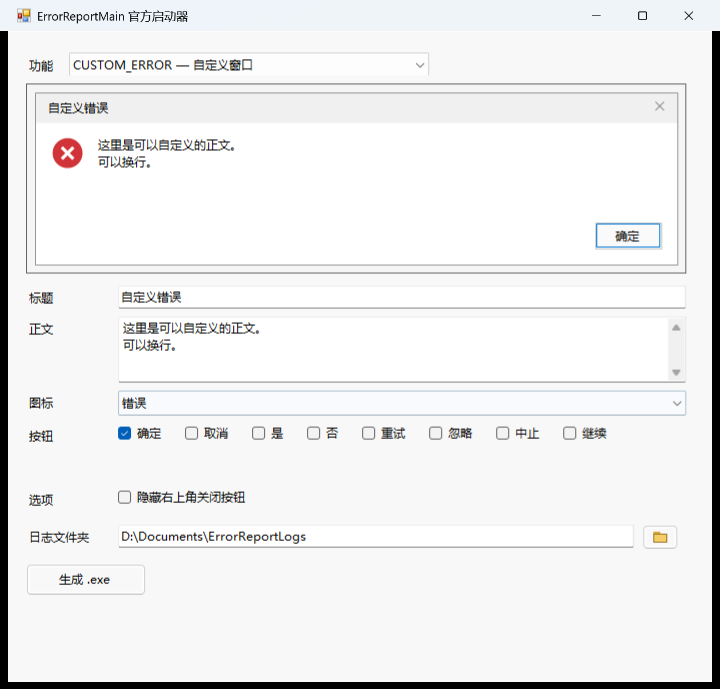
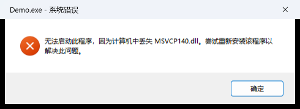

# ErrorReportMain 官方启动器

这是一个可选的图形化工具，用来自定义并生成“点开就弹错误框”的小 exe。
不想自己写 C/C++/C# 调用代码时，可以直接用这个启动器。

## 环境

- Windows 10 / 11
- .NET Framework 4.8（Windows 10 1903+ / Windows 11 自带）
- Visual Studio 2026 或 .NET SDK，用来构建启动器
- 先构建项目的 **x64 Release DLL**
- 当前启动器按 **x64** 构建，生成 exe 也按 x64 运行，必须配 x64 的 `ErrorReportMain.dll`
- 启动器和生成 exe 内嵌 comctl32 v6 manifest，使用 Windows 10/11 的现代按钮/图标；
  如果把 DLL 嵌入到没有 manifest 的原生宿主里，控件会退回经典样式

## 构建

在仓库根目录：

```powershell
# 1. 构建 DLL
msbuild ErrorReportMain.slnx /m /p:Configuration=Release /p:Platform=x64

# 2. 构建启动器
dotnet build Launcher/ErrorReportLauncher.csproj -c Release
```

启动器输出在：

```text
Launcher\bin\Release\net48\ErrorReportLauncher.exe
```

如果第 1 步已经生成 `x64\Release\ErrorReportMain.dll`，启动器的构建后步骤会把它复制到
`Launcher\bin\Release\net48\`。如果没复制，手动把 DLL 放到启动器 exe 旁边即可。

## 使用

1. 第一行下拉框选择四个接口之一：
   - `DLL_MISSING_ERROR`：只显示程序名、缺失模块。
   - `EXE_ERROR`：只显示程序名、异常名、错误代码、地址。
   - `MEMORY_ERROR`：只显示程序名、指令地址、被引用地址、访问类型。
   - `CUSTOM_ERROR`：标题、正文、图标下拉框、按钮勾选框、隐藏关闭按钮。
2. 中间是实时预览图，会跟随参数变化。
3. 底部“日志文件夹”可以：
   - 直接输入路径；
   - 或点击右侧文件夹图标，在弹出的浏览器中选择一个文件夹并确定。
4. 点击“生成 .exe”，选择保存位置。

自定义模式的按钮勾选框目前固定提供：

```text
确定 / 取消 / 是 / 否 / 重试 / 忽略 / 中止 / 继续
```

全部不勾选时，DLL 会使用默认的“确定”。

### 界面预览

预设错误模式：


自定义模式：



## 生成与播放

生成时会做三件事：

1. 把启动器自身复制成目标 exe；
2. 把 `ErrorReportMain.dll` 复制到目标 exe 同目录；
3. 把当前配置追加到目标 exe 末尾。

目标 exe 运行时：

- 检测到末尾配置，就进入**播放模式**，不显示启动器界面；
- 调用 DLL 弹出对应窗口；
- 用户关闭窗口后，在配置的日志文件夹写入 `.log`。

实际效果（`DLL_MISSING_ERROR`，已带 comctl32 v6 清单）：



## 日志

文件名：

```text
ErrorReport-yyyyMMdd-HHmmss.log
```

内容示例：

```text
Local Time: 2026-10-25 20:57:28
Function: DLL_MISSING_ERROR
ErrorProgram: Demo.exe
MissingDll: MSVCP140.dll
User Choice: 1
```

`User Choice` 是 DLL 的返回值：

- 前三个接口：`IDOK` = 1，`IDCANCEL` = 2；
- `CUSTOM_ERROR`：0 基按钮索引，`-1` 关闭，`-2` 失败；
- `MessageBoxW` 自身失败时可能是 0。

## 生成物说明

```text
你选择的目录\
├─ ErrorReportPlayer.exe   # 启动器副本 + 末尾配置
└─ ErrorReportMain.dll     # 播放时加载
```

生成 exe 需要 .NET Framework 4.8 才能运行；如果只把 exe 拷走、不带 DLL，
播放时会提示找不到 `ErrorReportMain.dll`，并把错误写进日志。

## 限制

- 启动器和生成 exe 当前都是 x64，不能配 Win32 DLL 使用。
- 生成 exe 依赖 .NET Framework 4.8；不是完全原生的单文件 exe。
- 图标只支持 `none` / `error` / `warning` / `info` / `question` 这些系统图标。
- 自定义按钮最多 8 个，排成一行。
- 日志文件夹是绝对路径，生成后换机器运行可能失效。
- 生成 exe 里仍包含启动器代码（用于预览和生成），但检测到末尾配置后只执行播放逻辑。

## 实现位置

- `Program.cs`：检测末尾配置，决定进入启动器还是播放模式。
- `PlayerConfig.cs`：配置结构和追加/读取逻辑。
- `PlayerRunner.cs`：P/Invoke DLL、弹窗、写日志。
- `Generator.cs`：复制启动器和 DLL、追加配置。
- `app.manifest`：comctl32 v6 视觉样式清单，会随启动器和生成 exe 一起嵌入。
- `MainForm.cs`：下拉框、参数控件、文件夹选择、生成。
- `PreviewPanel.cs`：GDI+ 绘制现代图标/按钮预览图。
