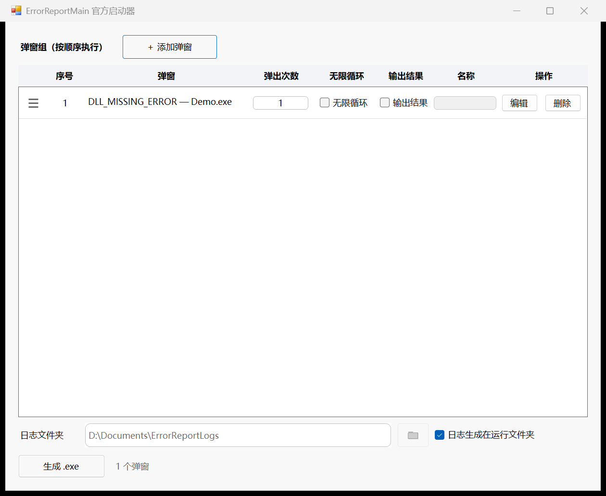
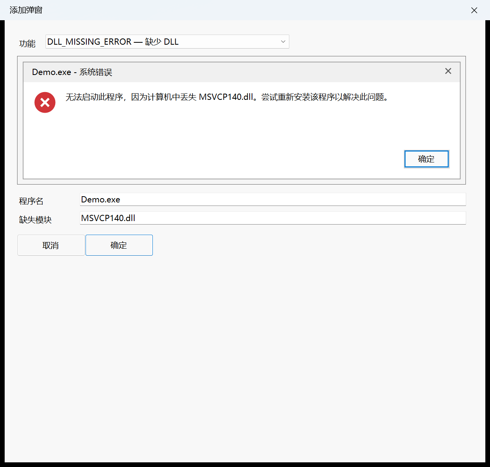

# ErrorReportMain

一个 Windows 动态链接库（DLL），用于在程序中复刻经典 Windows 系统错误弹窗，
并提供可完全自定义的错误窗口，以及使用标准 MessageBox 按钮的自定义消息框。
库本身不处理真实崩溃；它只负责显示界面，后续处理由调用方决定。

- 语言标准：C++20（`/std:c++20`），C 头文件兼容 C17
- 目标平台：Win32 / x64，Unicode（解决方案平台写作 x86，工程平台写作 Win32）
- 导出方式：`extern "C"` + `ErrorReportMain.def`，五个导出名在 x86/x64 下都无名称修饰
- 运行时依赖：仅 `KERNEL32.dll`、`USER32.dll`、`GDI32.dll`、`SHELL32.dll`（静态 CRT）

## 接口

三个复刻接口均返回 `MessageBoxW` 的返回值，参数为空指针或空字符串时使用内置默认文本，不会崩溃。
`CustomError` 返回按钮索引或错误码，`CustomMessageBox` 返回 `MessageBoxW` 的标准按钮 ID，见下文。
内存不足等极端情况下会退回固定文本提示，不会让 C++ 异常穿越 C 接口。

```c
int DllMissingError(const wchar_t* ErrorProgram, const wchar_t* MissingDll);
int ExeError(const wchar_t* ErrorProgram, const wchar_t* ErrorName,
              const wchar_t* ErrorCode, const wchar_t* Address);
int MemoryError(const wchar_t* ErrorProgram, const wchar_t* Operate,
                 const wchar_t* Address, const wchar_t* CannotBe);
int CustomError(const wchar_t* Title, const wchar_t* Text,
                 const wchar_t* Icon, const wchar_t* Buttons,
                 int HideCloseButton);
int CustomMessageBox(const wchar_t* Title, const wchar_t* Text,
                      const wchar_t* Icon, const wchar_t* Buttons);
```

| 接口 | 复刻的对话框 | 按钮 | 返回值 |
|---|---|---|---|
| `DllMissingError` | “无法启动此程序，因为计算机中丢失 xxx。尝试重新安装该程序以解决此问题。” | 确定 | `IDOK` |
| `ExeError` | “应用程序发生异常 xxx，位置为 xxx。” | 确定 / 取消 | `IDOK` / `IDCANCEL` |
| `MemoryError` | “xxx 指令引用的 xxx 内存。该内存不能为 xxx。” | 确定 / 取消 | `IDOK` / `IDCANCEL` |
| `CustomError` | 完全自定义窗口 | 由 `Buttons` 指定（最多 8 个） | 0 基按钮索引 / `-1` / `-2` |
| `CustomMessageBox` | 自定义标题/正文/图标的标准消息框 | 标准 MessageBox 组合 | MessageBox 按钮 ID / `0` / `-2` |

前三个接口的对话框标题统一为 `<程序名> - <分类>`，分类分别是“系统错误”“应用程序错误”；
程序名为空时显示“未知程序”。`CustomError` 和 `CustomMessageBox` 使用调用方传入的 `Title`，
不套用这个规则。

### 参数说明

| 接口 | 参数 | 含义 | 为空时的默认值 |
|---|---|---|---|
| 前三个接口 | `ErrorProgram` | 程序名，显示在标题栏 | `未知程序` |
| `DllMissingError` | `MissingDll` | 缺失的模块（DLL）名 | `未知模块` |
| `ExeError` | `ErrorName` | 异常名称，例如 `0xC0000005` | `未知异常` |
| `ExeError` | `ErrorCode` | 异常代码或描述 | `未知代码` |
| `ExeError` | `Address` | 出错地址 | `未知地址` |
| `MemoryError` | `Operate` | 指令地址 | `0x00000000` |
| `MemoryError` | `Address` | 被引用的内存地址 | `0x00000000` |
| `MemoryError` | `CannotBe` | 访问类型，通常为 `read` / `written` | `read` |

### 自定义窗口 CustomError

| 参数 | 含义 | 为空或默认 |
|---|---|---|
| `Title` | 窗口标题 | `错误` |
| `Text` | 正文，支持换行 | 空正文 |
| `Icon` | `error` / `warning` / `info` / `question` / `none`，大小写不敏感 | 无图标 |
| `Buttons` | 用竖线分隔的按钮文本，最多 8 个；第一个是默认按钮 | `确定` |
| `HideCloseButton` | 非 0 时隐藏标题栏关闭按钮，并忽略 X、Alt+F4 和 Esc | `0`（显示关闭按钮） |

返回值：

| 返回值 | 含义 |
|---|---|
| `0` … `N-1` | 被点击按钮的 0 基索引 |
| `-1` | 通过 X 或 Alt+F4 关闭（`HideCloseButton` 为 0 时） |
| `-2` | 参数错误（例如超过 8 个按钮）或窗口创建失败 |

行为：

- `Enter` 选择第一个按钮（默认按钮）。
- `HideCloseButton` 为 0 时，`Esc` 选择最后一个按钮；为 1 时 `Esc` 被忽略。
- 正文较长时，正文区域会变成带垂直滚动条的只读文本框，避免窗口超出屏幕。
- 图标只使用系统图标；不支持从 `.ico` 文件加载。
- 按钮文本中的 `&` 按 Win32 习惯作为加速键前缀，要显示字面量 `&` 请写成 `&&`。

#### 提示音

`CustomError` 在弹出的同时会播放与 `MessageBox` 相同的系统提示音，按 `Icon` 映射：

| `Icon` | 播放的系统声音 | 等价的 `MessageBeep` 参数 |
|---|---|---|
| `error` | Windows 关键停止音 | `MB_ICONERROR` |
| `warning` | Windows 感叹音 | `MB_ICONWARNING` |
| `info` / `information` | Windows 星号音 | `MB_ICONINFORMATION` |
| `question` | Windows 问题音 | `MB_ICONQUESTION` |
| `none` 或省略 | Windows 默认蜂鸣 | `MB_OK` |

这与 `MessageBox`（包括本库的 `CustomMessageBox` 和三个复刻接口）内部的行为一致：
它按 `uType & MB_ICONMASK` 取声音，`Icon` 为空时落到 `MB_OK`，即默认蜂鸣。
具体音色由控制面板的声音方案决定，用户关闭了系统提示音时不会发声；`MessageBeep`
无法播放指定声音时会退回系统默认音，再退回扬声器蜂鸣。

```cpp
const int choice = CustomError(
    L"自定义错误",
    L"这里是可以换行的自定义内容。\n第二行。",
    L"warning",
    L"重试|取消",
    0);

if (choice == 1) {
    // 用户点了“取消”
}
```

### 标准消息框 CustomMessageBox

使用标准 `MessageBoxW` 的按钮和系统图标，但标题、正文、图标和按钮组合由调用方指定。
按钮文本跟随系统语言，不支持自定义按钮文字；需要自定义文字请用 `CustomError`。

| 参数 | 含义 | 为空或默认 |
|---|---|---|
| `Title` | 消息框标题 | `错误` |
| `Text` | 正文，支持换行 | 空正文 |
| `Icon` | `error` / `warning` / `info` / `question` / `none`，大小写不敏感 | 无图标 |
| `Buttons` | `ok` / `okcancel` / `abortretryignore` / `yesnocancel` / `yesno` / `retrycancel` / `canceltrycontinue`，可追加 `"|help"` | `ok` |

```cpp
const int answer = CustomMessageBox(
    L"保存更改",
    L"文档已修改，是否保存？",
    L"question",
    L"yesnocancel");

if (answer == IDNO) {
    // 用户点了“否”
}
```

返回标准 `MessageBoxW` 按钮 ID（`IDOK` / `IDCANCEL` / `IDYES` / `IDNO` /
`IDABORT` / `IDRETRY` / `IDIGNORE` / `IDCONTINUE` / `IDTRYAGAIN` / `IDHELP`）；
`0` 表示 `MessageBoxW` 失败，`-2` 表示按钮组合非法。

## 目录结构

```
ErrorReportMain/
├─ ErrorReportMain.slnx            # 解决方案（VS 的 XML 解决方案格式）
├─ ErrorReportMain.vcxproj         # DLL 工程
├─ ErrorReportMain.def             # 模块定义文件，固定五个无修饰导出名
├─ CppProperties.json              # VS“打开文件夹”模式的 IntelliSense 配置
├─ Launcher/                       # 官方启动器（C# WinForms，可选）
├─ .gitignore
├─ include/                        # 公共接口，调用方只需包含这里
│  ├─ ErrorReport.h                # 总入口头文件
│  └─ ErrorReport/
│     ├─ Export.h                  # 导出/导入/静态宏
│     ├─ CustomError.h             # 完全自定义窗口
│     ├─ CustomMessageBox.h        # 标准 MessageBox 按钮的自定义消息框
│     ├─ DLLMissingError.h
│     ├─ ExeError.h
│     ├─ MemoryError.h
│     └─ Detail/
│        └─ MessageBoxError.h  # 文本兜底、标题拼接、owner 选择与 MessageBoxW 封装
├─ src/                            # 内部实现
│  ├─ dllmain.cpp                  # DLL 入口点（空实现）
│  ├─ CustomError.cpp              # 自定义窗口：布局、图标、按钮、隐藏关闭按钮
│  ├─ CustomMessageBox.cpp         # 标准 MessageBox 按钮的自定义消息框
│  ├─ DLLMissingError.cpp
│  ├─ ExeError.cpp
│  ├─ MemoryError.cpp
│  └─ Detail/
│     └─ MessageBoxError.cpp   # 上面头文件的实现
├─ pch.h / pch.cpp                 # 预编译头（仅内部使用）
├─ framework.h                     # windows.h 等系统头
└─ cpp.hint                        # VS 辅助提示
```

公共接口只依赖 `include/`，内部实现全部放在 `src/`，调用方无需接触预编译头。
`ErrorReportMain.def` 是导出名稳定的关键：它把五个 `extern "C"` 函数以无修饰名字导出，
避免 x86 下 `__cdecl` 的 `_DllMissingError` 之类修饰名进入导出表。

函数实现使用大驼峰命名（`DllMissingError` 等）。为兼容旧代码，`.def` 把旧的
`SCREAMING_SNAKE_CASE` 名字作为别名一并导出（例如 `DLL_MISSING_ERROR=DllMissingError`），
同时每个接口头文件用宏把旧名映射到新名（例如 `#define DLL_MISSING_ERROR DllMissingError`）；
因此按旧名调用或按旧名查找导出的调用方无需改动即可继续使用。

## 构建

用 Visual Studio 打开 `ErrorReportMain.slnx`，选择 `Debug`/`Release` 与 `x86`/`x64` 后生成。
`.slnx` 是较新的解决方案格式，需要支持它的 Visual Studio（VS 2022 17.14 及以上或 VS 2026）；也可以直接打开 `ErrorReportMain.vcxproj`。

解决方案里的平台名是 `x86`/`x64`，工程里的平台名是 `Win32`/`x64`，二者对应同一个 Win32 目标。在 VS 的配置下拉框中选择 `x86` 即构建 Win32；命令行直接构建工程时则要写 `Win32`：

```powershell
# x64（解决方案）
msbuild ErrorReportMain.slnx /m /p:Configuration=Release /p:Platform=x64

# Win32（直接构建工程；解决方案模式请按 .slnx 中实际列出的平台名传参）
msbuild ErrorReportMain.vcxproj /m /p:Configuration=Release /p:Platform=Win32
```

项目不锁定具体工具集：VS 2022 默认使用 v143，VS 2026（`VisualStudioVersion` 为 18.0）默认使用 v145，可在命令行用 `/p:PlatformToolset=...` 覆盖。

导出名由 `ErrorReportMain.def` 固定，构建后可以在 Developer Command Prompt / Developer PowerShell 中验证：

```powershell
dumpbin /exports x64\Release\ErrorReportMain.dll
dumpbin /exports Release\ErrorReportMain.dll
```

两个产物都应列出 `DllMissingError`、`ExeError`、`MemoryError`、`CustomError`、`CustomMessageBox`，
以及向后兼容的旧名别名 `DLL_MISSING_ERROR`、`EXE_ERROR`、`MEMORY_ERROR`、`CUSTOM_ERROR`、`CUSTOM_MESSAGEBOX`。
x86 的输出会写成 `DllMissingError = _DllMissingError`：等号左边是导出名（无修饰），右边是 DLL 内部的
C 修饰符号；判断导出名时以等号左边为准。

产物位于 `x64\Release\`（Win32 对应 `Release\`，没有额外的 `Win32\` 子目录）：

```
ErrorReportMain.dll   # 运行时需要
ErrorReportMain.lib   # 链接导入库时使用
ErrorReportMain.pdb   # 调试符号
```

源文件统一使用 UTF-8 编码，工程已开启 `/utf-8`，中文提示文本不会随系统区域设置变化。

## 使用

### 方式一：链接导入库

```cpp
#include <ErrorReport.h>

int main() {
    ExeError(L"Demo.exe", L"0xC0000005",
              L"Access violation", L"0x00007FF612340000");
    return 0;
}
```

在调用方工程中：

1. 包含路径添加 `ErrorReportMain/include`；
2. 链接 `ErrorReportMain.lib`；
3. 运行时把 `ErrorReportMain.dll` 放到可执行文件目录或 `PATH` 中；
4. 若调用方工程启用了预编译头，不要包含 `pch.h`，公共头文件与预编译头无关。

> 公共头文件使用 UTF-8 编码。调用方若使用 MSVC 且源码页不是 UTF-8，建议在工程中开启 `/utf-8`；否则包含这些头文件时可能看到 C4819 警告（只是注释编码提示，不影响生成）。

### 方式二：运行时加载

```cpp
#include <windows.h>

using DllMissingErrorFn = int (__cdecl*)(const wchar_t*, const wchar_t*);

HMODULE module = LoadLibraryW(L"ErrorReportMain.dll");
if (module != nullptr) {
    auto showError = reinterpret_cast<DllMissingErrorFn>(
        GetProcAddress(module, "DllMissingError"));
    if (showError != nullptr) {
        showError(L"Demo.exe", L"MSVCP140.dll");
    }
    FreeLibrary(module);
}
```

> 导出函数使用默认的 `__cdecl` 调用约定，`GetProcAddress` 得到的函数指针需按 `__cdecl` 声明。导出名由 `.def` 固定，x86/x64 都可以直接用 `DllMissingError` 等名字查找。C# 等语言可通过 `DllImport` 调用；注意同时设置 `ExactSpelling = true` 和 `CallingConvention = CallingConvention.Cdecl`，否则 CLR 会查找 `...W` 后缀，且 x86 下默认的 StdCall 会破坏栈。
>
> `CustomError` 的函数指针类型是 `int (__cdecl*)(const wchar_t*, const wchar_t*, const wchar_t*, const wchar_t*, int)`，用同样的 `GetProcAddress(module, "CustomError")` 方式获取。

### C# 示例

```csharp
using System.Runtime.InteropServices;

internal static class ErrorReport
{
    [DllImport("ErrorReportMain.dll",
               CharSet = CharSet.Unicode,
               ExactSpelling = true,
               CallingConvention = CallingConvention.Cdecl)]
    internal static extern int DllMissingError(string errorProgram, string missingDll);

    [DllImport("ErrorReportMain.dll",
               CharSet = CharSet.Unicode,
               ExactSpelling = true,
               CallingConvention = CallingConvention.Cdecl)]
    internal static extern int CustomError(string title, string text,
                                            string icon, string buttons,
                                            int hideCloseButton);

    [DllImport("ErrorReportMain.dll",
               CharSet = CharSet.Unicode,
               ExactSpelling = true,
               CallingConvention = CallingConvention.Cdecl)]
    internal static extern int CustomMessageBox(string title, string text,
                                                 string icon, string buttons);
}
```

```csharp
int choice = ErrorReport.CustomError(
    "自定义错误", "正文", "warning", "重试|取消", 0);

if (choice == 1)
{
    // 用户点了“取消”
}
```

```csharp
int answer = ErrorReport.CustomMessageBox(
    "保存更改", "文档已修改，是否保存？", "question", "yesnocancel");

if (answer == 7)
{
    // IDNO：用户点了“否”
}
```

### Python（ctypes）示例

`ctypes.CDLL` 使用 `cdecl`，和 DLL 的调用约定一致；`str` 默认按 `wchar_t*` 传递，
因此可以直接调用：

```python
import ctypes

lib = ctypes.CDLL("./ErrorReportMain.dll")
lib.CustomError.argtypes = [ctypes.c_wchar_p] * 4 + [ctypes.c_int]
lib.CustomError.restype = ctypes.c_int

choice = lib.CustomError("自定义错误", "正文", "error", "确定|取消", 0)
# choice: 0 = 确定, 1 = 取消, -1 = 关闭, -2 = 失败

lib.CustomMessageBox.argtypes = [ctypes.c_wchar_p] * 4
lib.CustomMessageBox.restype = ctypes.c_int

answer = lib.CustomMessageBox("保存更改", "文档已修改，是否保存？", "question", "yesnocancel")
# answer: 6 = 是, 7 = 否, 2 = 取消, 0 = 失败, -2 = 参数错误
```

### 视觉样式（为什么有时显示经典按钮）

`MessageBoxW`、`CustomError` 和 `CustomMessageBox` 里的标准控件都使用**宿主进程**的视觉样式：

- 带 `Microsoft.Windows.Common-Controls` 6.0 manifest 的宿主会显示 Windows 10/11 的现代图标和扁平按钮；
- 不带这个 manifest 的原生宿主会退回到经典样式，看起来像 Windows 2000。

这不是 DLL 内部能单独切换的开关。Python 官方安装包的 `python.exe` 通常自带 comctl32 v6
manifest，所以用 `ctypes.CDLL("ErrorReportMain.dll")` 调用时是现代的；仓库自带的启动器和
生成 exe 也已经内嵌 [Launcher/app.manifest](Launcher/app.manifest)，所以同样是现代的。

自己写原生 C++ 宿主时，可以给宿主 exe 加：

```cpp
#pragma comment(linker, "/manifestdependency:\"type='win32' name='Microsoft.Windows.Common-Controls' version='6.0.0.0' processorArchitecture='*' publicKeyToken='6595b64144ccf1df' language='*'\"")
```

或者给宿主工程添加一个带 comctl32 v6 依赖的 app.manifest。C# WinForms 宿主即使调用了
`Application.EnableVisualStyles()`，也建议在 exe 里嵌入这个 manifest，原生 `MessageBoxW`
才会稳定使用当前主题。否则按钮/图标会保持经典样式，但 DLL 的文本、弹窗逻辑和返回值都不受影响。

DPI 同理：启动器/生成 exe 通过 [Launcher/app.manifest](Launcher/app.manifest) 声明
system DPI awareness；启动器用 [Launcher/DpiHelper.cs](Launcher/DpiHelper.cs) 从窗口读取
实际 DPI 并按物理像素布局，不再依赖外部 `ErrorReportLauncher.exe.config`。175% 缩放下
不需要在兼容性里手动设置“替代高 DPI 缩放行为”。自定义 DLL 本身不设置进程 DPI，
实际清晰度仍由宿主进程决定。

## 官方启动器

> **【开发中】输出结果功能**
> 该功能仍在开发中，**非必要不要使用**；当前只把点击结果写入日志和 `ErrorReportVectors.cpp`，`Return`/文件上传尚未接入。

`Launcher/` 提供一个可选的 C# WinForms 启动器，不想自己写调用程序时可以用它生成
“点开就弹错误框”的 exe。它支持：

- 以“弹窗组”为单位组织多个弹窗，每一行是一个弹窗，带序号、摘要、弹出次数和无限循环；
- “添加弹窗”打开原来的弹窗编辑界面：五个接口、各自参数、实时预览、确定/取消；
- 每行右侧有编辑和删除按钮；行可以拖动调整顺序；
- 弹出次数支持正整数；勾选“无限循环”后次数显示为 `∞` 并变灰，取消后恢复为 `1`；
- **【开发中】**每个弹窗可勾选“输出结果”并填写名称；弹窗 n 次循环结束后把点击结果写成
  `std::vector<int>` 形式的日志，例如 `vec1 = { 1, 1, 2 }`（非必要不要使用）；
- **【开发中】**全部播放结束后自动在 exe 所在目录生成 `ErrorReportVectors.cpp`，内容为
  `#include <vector>` 和勾选名称的实际 `std::vector<int> 名称 = { ... };`；
- 如果无限循环弹窗不是最后一个，生成时会报错，因为后面的弹窗永远不会执行；
- 日志文件夹可直接输入，也可点右侧文件夹图标浏览选择；
- 可勾选“日志生成在运行文件夹”，让生成 exe 把日志写在自身所在目录，忽略上面的日志文件夹；
- 点击“生成 .exe”输出单文件播放器，x64 DLL 会一起写入 exe 末尾；生成物可以单独移动，不再需要旁边的 `ErrorReportMain.dll`。





构建（先构建 x64 DLL）：

```powershell
msbuild ErrorReportMain.slnx /m /p:Configuration=Release /p:Platform=x64
dotnet build Launcher/ErrorReportLauncher.csproj -c Release
```

运行：

```text
Launcher\bin\Release\net48\ErrorReportLauncher.exe
```

启动器和生成的播放器需要 **.NET Framework 4.8**，当前按 **x64** 构建。启动器自身生成时
需要同目录的 x64 `ErrorReportMain.dll`（`Launcher.zip` 已包含）；生成出的 exe 会把 x64 DLL
内嵌，可以单独移动，不再需要外部 DLL。启动器/生成 exe 已内嵌 comctl32 v6 manifest；
启动器通过 `DpiHelper` 读取实际 DPI 并手动缩放，不再需要 `ErrorReportLauncher.exe.config`，
175% 缩放下会按物理像素渲染，不需要在兼容性里手动设置“替代高 DPI 缩放行为”。详细说明见
[Launcher/README.md](Launcher/README.md)。

### Windows 7 说明

- Windows 7 没有官方“SP2”，最后版本是 **SP1**。这里按 Windows 7 SP1 x64 处理。
- 系统必须已安装 **.NET Framework 4.8**；干净安装的 Win7 默认没有，不能保证“双击就开”。
- 当前启动器和生成 exe 仅提供 **x64**；32 位 Win7 不能运行。
- DLL 已把 `_WIN32_WINNT` 设为 `0x0601`，并确认没有静态导入
  `GetDpiForWindow` / `AdjustWindowRectExForDpi` 等 Win10+ DPI API；这些调用在运行时动态加载，
  缺失时回退到 GDI。
- 启动器在 Win7/8/8.1 上把次数/日志路径输入框退回系统原生 `EDIT` 控件，按钮和复选框由
  comctl32 v6 使用系统视觉样式。
- **不能承诺“所有元素自动变成 Win7 原生样子”**：弹窗组行、表头、拖拽柄、预览面板是应用自绘的，
  不会随系统自动变成 Win7 原生控件；要逐像素原生 Win7 外观必须整体改用系统控件。
- 以上是静态兼容性检查，**没有在真实 Windows 7 机器上跑过**，因此不能给出 100% 保证。

## 设计说明

- 文本通过 `std::wstring` 拼接，不使用固定长度栈缓冲区，不存在截断或格式字符串不匹配问题。
- 所有参数均做空指针/空串保护，传入 `nullptr` 不会崩溃。
- 公共头文件不包含 `pch.h`，可安全地被外部工程包含（包括 C 源文件）。
- `pch.h` 只预编译 `windows.h` 和稳定、常用的标准库头文件；项目头文件仍由各 `.cpp` 直接包含，
  以保证声明、`extern "C"` 链接和依赖关系清晰。
- 导出名由 `ErrorReportMain.def` 固定；构建 DLL 时 `ERRORREPORT_API` 为空，链接 DLL 时为 `__declspec(dllimport)`，静态编译时为空。仓库工程只生成 DLL，如需把实现直接编入调用方，可手动编译 `src/` 中的实现文件（通常排除 `src/dllmain.cpp`）并定义 `ERRORREPORTMAIN_STATIC`（不需要 `.def`）。迁移到其他构建系统时，记得保留 `.def` 或改用 `__declspec(dllexport)`。
- 消息框优先挂到调用线程的活动窗口；没有活动窗口时，只接受同进程的前台窗口，避免对话框被其他窗口遮挡或错误绑定到其他进程。
- `CustomError` 使用内存中的对话框模板加标准 `STATIC` / `BUTTON` / `EDIT` 控件，背景使用 `COLOR_WINDOW`，图标来自 shell 的现代库存图标；控件外观跟随宿主视觉样式。
- `CustomMessageBox` 复用 `MessageBoxW` 的 owner 选择和标题拼接逻辑，按钮组合/图标映射为标准 MessageBox 标志；不支持自定义按钮文字或隐藏关闭按钮。
- `CustomError` 在 `WM_INITDIALOG` 里调用 `MessageBeep`，按图标播放与 `MessageBox` 一致的系统提示音（见“提示音”）；声音异步播放，不阻塞窗口显示。
- `CustomError` 在创建时按 owner 所在显示器的 DPI 计算尺寸并居中；正文太长时切换为带垂直滚动条的只读 `EDIT`，避免长文本把窗口撑得过高。
- `HideCloseButton` 通过移除 `WS_SYSMENU` 和系统菜单里的 `SC_CLOSE` 实现，同时在消息处理中忽略 X、Alt+F4 和 Esc。
- 导出函数捕获所有 C++ 异常；内存不足等情况下退回固定文本，不让异常穿越 C 接口。
- 使用静态 CRT（Debug 为 `/MTd`，Release 为 `/MT`），DLL 只依赖 `KERNEL32.dll`、`USER32.dll`、`GDI32.dll` 和 `SHELL32.dll`，目标机器无需安装 VC++ 运行库。
- 工程开启 `/W4`、SDL 检查与多处理器编译，Debug/Release 均生成调试信息。

## 已知限制

- 本库只负责弹窗，不捕获真实崩溃、不生成 dump，也不判断进程是否真的处于异常状态。
- 视觉样式由宿主 manifest 决定：带 comctl32 v6 的宿主使用 Windows 10/11 现代按钮/图标；没有 manifest 的原生宿主显示经典样式（见“视觉样式”）。
- 文本和布局仍然是经典错误框的复刻，不会与 XP 弹窗逐像素一致；如果要求逐像素，需要自绘对话框。
- `CustomError` 最多支持 8 个按钮，且只排成一行；按钮文本过长会把窗口撑宽。
- `CustomError` 的图标只支持 `error` / `warning` / `info` / `question` / `none` 这几个系统图标，不支持从 `.ico` 文件加载自定义图标。
- `CustomError` 的按钮文本把 `&` 当作 Win32 加速键前缀；要显示字面量 `&` 请写成 `&&`。
- `CustomError` 的提示音取自系统声音方案，无法单独关闭，也不能指定自定义音效。
- `CustomError` 在窗口打开期间不会跟随显示器 DPI 变化重新布局；初始 DPI 和居中位置是正确的。
- `CustomMessageBox` 只能使用标准 MessageBox 按钮组合，按钮文本跟随系统语言，不支持自定义按钮文字或隐藏关闭按钮。
- `CustomMessageBox` 的 `"|help"` 只会显示“帮助”按钮，不提供帮助内容的处理回调。
- 启动器弹窗组最多 1000 个弹窗；无限循环弹窗必须是最后一个，否则生成时会报错。
- 无限循环会持续写日志，文件会不断增长；需要停止时只能结束播放器进程。
- 启动器勾选“日志生成在运行文件夹”时，如果 exe 位于 Program Files 等只读目录，日志会写入失败；请改用可写目录。
- 提示文本目前是简体中文硬编码，没有资源 DLL 或多语言切换。
- 仓库没有自动化测试；可以使用 `Launcher/` 启动器手工生成并验证弹窗和日志。
